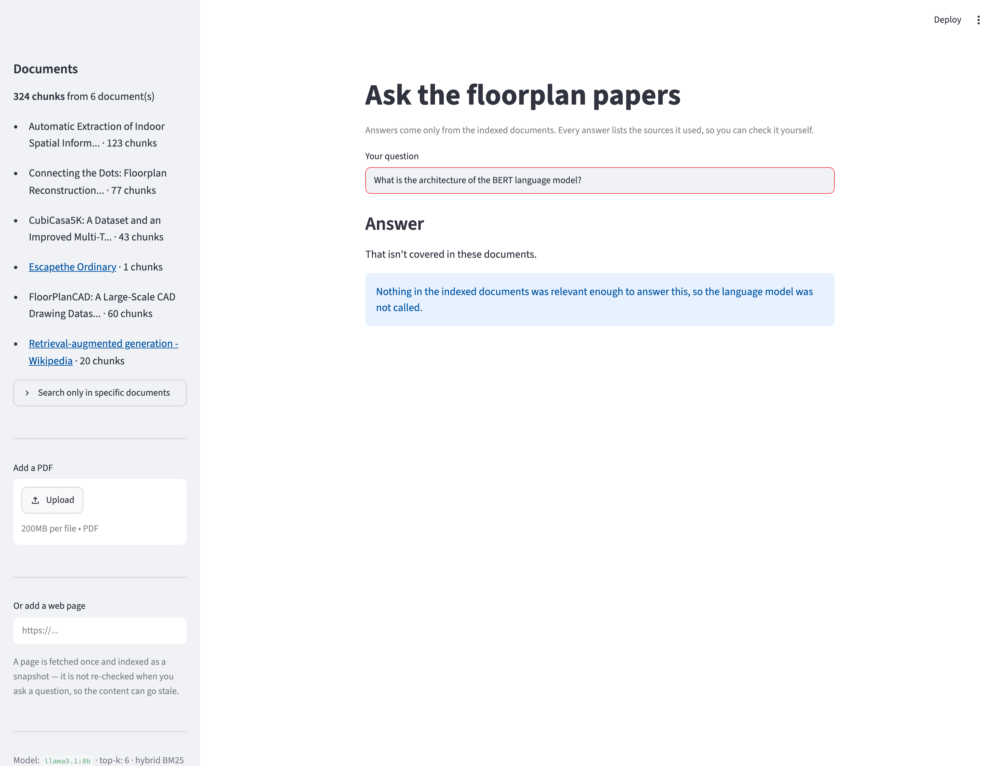
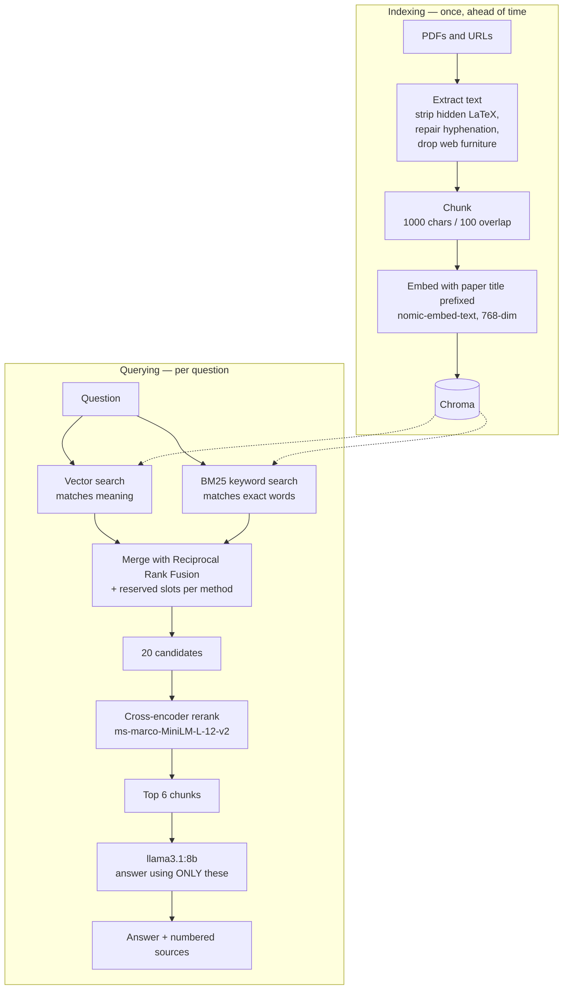

# Ask My Papers — a RAG system with citations you can check

Ask questions about a set of research papers (or any web page) and get an answer that
comes **only** from those documents, with the exact source text shown next to it.

Runs entirely locally — no API keys, no cloud, no per-query cost.

![The app answering a question, with source [1] expanded to show the exact text the model was given](docs/screenshot-answer.png)

The answer says 5,000 — and the expanded source shows the paragraph it came from, so the
claim is checkable rather than trusted.

Ask it something the documents don't cover and it says so, instead of inventing an
answer:



That second behaviour is the point of the project. The model *knows* what BERT is —
refusing proves it is answering from the documents rather than from memory. In this case
the model was never called at all: nothing cleared the relevance threshold, so there was
nothing to answer from.

---

## Why this exists

I built this to learn how retrieval-augmented generation actually works, rather than to
wire together a tutorial. Every design decision in here was made after measuring
something, and the interesting parts of the project are the bugs — several of which were
completely invisible in the output while quietly wrecking retrieval quality.

The full reasoning lives in three working documents:

- **[ARCHITECTURE.md](ARCHITECTURE.md)** — every decision and why, plus open problems
- **[PROGRESS.md](PROGRESS.md)** — a daily log of what broke and what it taught me
- **[CONCEPTS.md](CONCEPTS.md)** — plain-English explanations of every concept involved
- **[EVAL_QUESTIONS.md](EVAL_QUESTIONS.md)** — the evaluation set and its results

---

## Results

**Retrieval** — scored against 16 questions labelled with the document and page that
actually contain the answer (`eval_retrieval.py`):

| k | hit@k | doc@k | MRR |
|---|---|---|---|
| 1 | 62% | 100% | 0.625 |
| 3 | 94% | 100% | 0.771 |
| **6 (used)** | **100%** | **100%** | **0.783** |

- `hit@k` — a chunk from the right document and page reaches the prompt
- `doc@k` — the right document is retrieved at all
- `MRR` — mean reciprocal rank of the first correct chunk

**Answers** — 18 questions across six categories: specific numbers, correct-source
attribution, multi-chunk synthesis, paraphrased wording, "why" questions, and refusing
questions the documents don't answer (`run_eval.py`, verdicts in
[EVAL_QUESTIONS.md](EVAL_QUESTIONS.md)).

**14 pass, 1 partial** on the main set, with both refusal tests passing. The remaining
failures are documented below rather than hidden.

---

## How it works



Three surfaces on top of the same pipeline: a CLI (`ask.py`), a JSON API (`api.py`), and
a web UI (`app.py`).

---

## Design decisions worth explaining

**Hybrid retrieval, because vector search alone measurably failed.**
All four papers are about floorplans, so they sit almost on top of each other in meaning
space — the only thing distinguishing them is a proper noun, which is exactly what
embeddings compress away. Measured: the chunk listing one paper's three contributions
ranked **#250** by vector search and **#1** by keyword search. Adding BM25 alongside
turned two hard failures into passes.

**A cross-encoder reranker, because the numbers said so.**
`hit@10` was already 100% while `hit@6` was 94% — the right chunk was being *found* but
not ranked high enough to reach the prompt. That specific gap is what reranking fixes, so
retrieval now returns 20 candidates and a cross-encoder rescores them to 6.
Result: hit@6 94% → 100%, MRR 0.677 → 0.783, and two previously-broken questions fixed.

**Titles prefixed at embedding time.**
A chunk from the middle of a paper says "our dataset" and never names it, so nothing in
its embedding ties it to its source. Prefixing each chunk with its paper title before
embedding took `doc@k` to 100% at every k.

**A relevance threshold, made possible by the reranker.**
Reranker scores are comparable across questions in a way cosine distances are not.
Measured on a deliberately mixed corpus: relevant chunks score 0.85-1.00, irrelevant ones
score **exactly 0.0000**. Chunks below 0.05 are dropped, and if nothing survives the
model is never called — an out-of-scope question is answered in 1.0s instead of ~6s, with
no opportunity to hallucinate. Retrieval metrics were unchanged.

**An explicit refusal string.**
The prompt gives the model a sanctioned way to decline. Without one, a model strains to
answer from training data rather than admit the text isn't there.

**Tests written against real bugs.**
The suite is mostly regression tests for the failures listed below — hidden LaTeX,
hyphenated line breaks, duplicate chunks on re-indexing. Verified by reintroducing the
original bugs and confirming 7 tests failed, because a test that has never failed may be
asserting nothing.

**Local-only, deliberately.**
Ollama for both embeddings and generation; Chroma in-process; a 21 MB ONNX reranker with
no PyTorch. No keys, no costs, nothing to operate.

---

## Bugs worth reading about

Every one of these was **invisible in the output** — answers looked plausible throughout.
All were found by measuring, not by reading answers.

**A quarter of the index was garbage.**
One paper embeds the LaTeX source of every equation as hidden text — invisible to a
reader, extracted by pypdf as long base64 blobs. 94 blocks, **44% of that document's
characters**, 57% of its chunks. Found by noticing one paper produced 165 chunks from 15
pages while a similar paper produced 43 from 12.

**568 words that no search could ever match.**
Justified text hyphenates across line breaks, so the PDFs contain `FloorPlan-\nCAD` and
`con-\ntaining`. The token "floorplancad" did not exist anywhere in the corpus, making it
unfindable by keyword search. Repaired at load time, plus hyphen-insensitive tokenising.

**Rank fusion burying the one chunk that mattered.**
Reciprocal Rank Fusion rewards agreement between methods, so a chunk ranked #1 by keyword
and #250 by vector lost to chunks both methods rated mediocre. Each method now gets
reserved slots before RRF fills the rest.

**The model inventing arithmetic.**
Given "2,500 files" and "over 100 projects" from one page and "over 15,000 floor plans"
from another, it multiplied the first two and presented the product as fact. The prompt
now forbids calculating or inferring unstated numbers.

---

## Known limitations

Kept deliberately, and each one diagnosed:

- **"Why" questions retrieve the wrong section.** Asking why a mechanism exists returns
  results and ablation text rather than the motivation, because motivation is written in
  the *problem's* vocabulary and never names the mechanism, while ablation text is full of
  its name. Reranking fixed the retrieval half — the right chunk now reaches the prompt —
  but the model still answers from the ablation text.
- **Competing figures confuse an 8B model.** One paper states two different counts in
  different contexts and the answer sometimes leads with the wrong one.
- **Figure and table text still pollutes chunks.** Diagram labels extracted as text
  (`[D6]ConvTranspose(512,512,2,2)`) become chunk content. Harder than the LaTeX case,
  because nothing marks it as junk.
- **JavaScript-rendered pages return nothing.** Only the initial HTML is fetched, so
  sites that build content in the browser yield no text. Reported explicitly rather than
  failing silently. A headless browser would fix it.
- **hit@k is slightly optimistic.** Ground truth is labelled per page, and a page holds
  several chunks.
- **No chunk cap per URL.** Nothing stops one large site adding thousands of chunks.

---

## Running it locally

Requires [Ollama](https://ollama.com).

```bash
# models (about 5 GB)
ollama pull nomic-embed-text
ollama pull llama3.1:8b

# environment
python3 -m venv .venv
source .venv/bin/activate
pip install -r requirements.txt

# build the index from the PDFs in data/
python build_index.py

# ask a question
python ask.py "How many samples does the CubiCasa5K dataset contain?"
```

Web UI, with PDF and URL upload:

```bash
streamlit run app.py
```

JSON API:

```bash
uvicorn api:app --reload
curl -X POST localhost:8000/ask \
  -H 'Content-Type: application/json' \
  -d '{"question":"What is panoptic symbol spotting?"}'
```

Evaluation:

```bash
python eval_retrieval.py   # retrieval metrics, with and without reranking
python run_eval.py         # end-to-end answers for the full question set
```

Tests — 38 of them, no network or model calls, well under a second:

```bash
pytest
```

---

## Repository layout

| File | What it does |
|---|---|
| `ingest.py` | Loads PDFs, strips hidden LaTeX, repairs hyphenation, flags pages with no text |
| `web.py` | Fetches a URL and extracts the main article text |
| `build_index.py` | Chunks, embeds and stores documents in Chroma |
| `retriever.py` | Hybrid BM25 + vector search, RRF merge, cross-encoder reranking |
| `ask.py` | The prompt, the generation call, and the CLI |
| `api.py` | FastAPI service — `POST /ask`, `GET /health` |
| `app.py` | Streamlit UI with PDF and URL upload |
| `eval_retrieval.py` | Retrieval metrics against labelled ground truth |
| `run_eval.py` | End-to-end answer evaluation |
| `chunk_test.py` | The chunk-size experiment used to pick 1000/100 |
| `tests/` | 38 tests, mostly regression tests for the bugs listed above |
| `tools/capture_screenshots.py` | Regenerates the README screenshots via a headless browser |

---

## Documents indexed

Four papers on floorplan analysis (60 pages, 303 chunks), chosen because they are a
domain I am actually working in rather than a generic sample set:

- **CubiCasa5K** — a 5,000-sample floorplan image dataset and multi-task CNN
- **FloorPlanCAD** — a 15,000-drawing CAD dataset and the panoptic symbol spotting task
- **RoomFormer** — floorplan reconstruction from 3D scans using two-level queries
- **Patch-based floor plan analysis** — CNN on normalised patches for large buildings

Any web page can be indexed alongside them from the UI, which is why the screenshots
above show a higher chunk count than 303.

---

## What I would do next

1. **Query expansion for "why" questions** — search for the problem a mechanism solves,
   not only the mechanism's name.
4. **A larger model** — retrieval is at 100% hit@6, so every remaining failure is the
   model misreading text it was correctly given.
